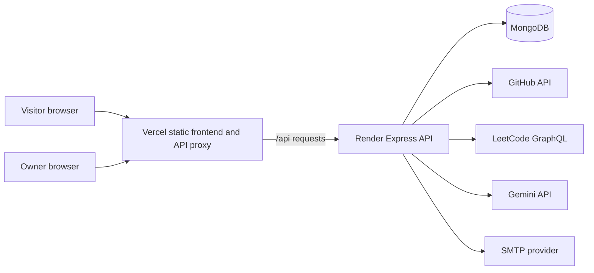

# Architecture and System Design

## Scope

The application is a single-owner portfolio with public profile, project, blog, activity, contact, and assistant experiences, plus a protected content editor. It uses a static React client, a Node.js/Express API, and MongoDB.

## System Context

## Runtime Components

| Component | Responsibility | Current implementation |
| --- | --- | --- |
| Frontend | Public pages, admin editor, contact form, assistant UI | React 19 + TypeScript + Vite; static build hosted by Vercel |
| API proxy | Same-origin `/api/*` forwarding from Vercel | Serverless function at `frontend/api/[...path].js`; buffers request and response bodies |
| Backend | Public API, authentication, content writes, integrations | Express 4 + TypeScript on Render |
| Content store | Portfolio document, admin account, contact submissions | MongoDB through Mongoose |
| External providers | Contribution calendars, chat generation, contact email | GitHub, LeetCode, Gemini, SMTP |

## Request Flows

### Public portfolio

1. The browser loads the static Vite application and can render cached or bundled portfolio content immediately.
2. The client requests `GET /api/portfolio` and replaces its fallback content when the response arrives.
3. The backend caches the public portfolio projection in process memory for 60 seconds. Public responses omit blogs with `published: false`.
4. The client stores only the public response in local storage. Project and blog detail routes use the same portfolio payload; malformed stored slugs fall back to title-derived slugs.

### Admin content update

1. The owner submits credentials to `POST /api/auth/login`.
2. The API validates the password against its bcrypt hash and returns an eight-hour JWT.
3. The client keeps the token in React state and requests `GET /api/portfolio/admin` with a Bearer token. This response includes drafts and uses `Cache-Control: no-store`.
4. Content writes use authenticated `PUT` endpoints. The backend persists the portfolio document, refreshes its public cache projection, and returns the updated portfolio to the authenticated client.

### Contact message

The API validates the submitted fields and writes a `ContactMessage` document first. If SMTP is configured, it attempts email delivery asynchronously and records the resulting status. MongoDB is the durable record; email delivery is not guaranteed by the HTTP acknowledgement.

### Activity calendars

The client schedules the activity request after the page becomes idle. The API calls GitHub and LeetCode concurrently with `Promise.allSettled`, applies ten-second provider timeouts, and caches results for five minutes per process. One provider failure does not suppress the other provider's result; if both fail, the client shows an error instead of an endless loading state.

### Portfolio assistant

The backend loads a limited public portfolio context and sends it with the recent chat turns to Gemini. The key remains server-side. The app does not persist chat transcripts.

## Data Ownership

- MongoDB is authoritative for editable portfolio content and contact submissions.
- `defaultContent` is only an initial seed if no portfolio document exists; it is not the live edit source after seeding.
- GitHub and LeetCode remain the authorities for activity data. The portfolio API normalizes their responses for the UI.
- SMTP is a notification channel, not the contact-message system of record.
- The Gemini service generates replies; the portfolio itself is the source of factual context.

## Design Decisions and Tradeoffs

- Separate frontend and API deployments allow static assets to use a CDN while the API and database credentials stay server-side.
- A single portfolio document keeps the admin editor simple and makes reads straightforward, but all content updates contend on one document and the payload grows with content.
- The short in-process cache reduces repeated portfolio reads on one backend process, but it is not shared among Render instances.
- The client can show cached or bundled content while dynamic data loads, trading immediate freshness for resilience and perceived speed.
- The system intentionally has few moving parts. That is appropriate at portfolio scale, but queues, distributed caching, and more deployment units should be added only when traffic or operating requirements justify them.

## Known Boundaries

The API currently has a liveness-only health route, no graceful shutdown handler, no automated test script, no structured metrics/tracing, no contact-message inbox, and no durable background job runner. See [operations](operations.md), [security](security.md), and [scalability](scalability.md).
